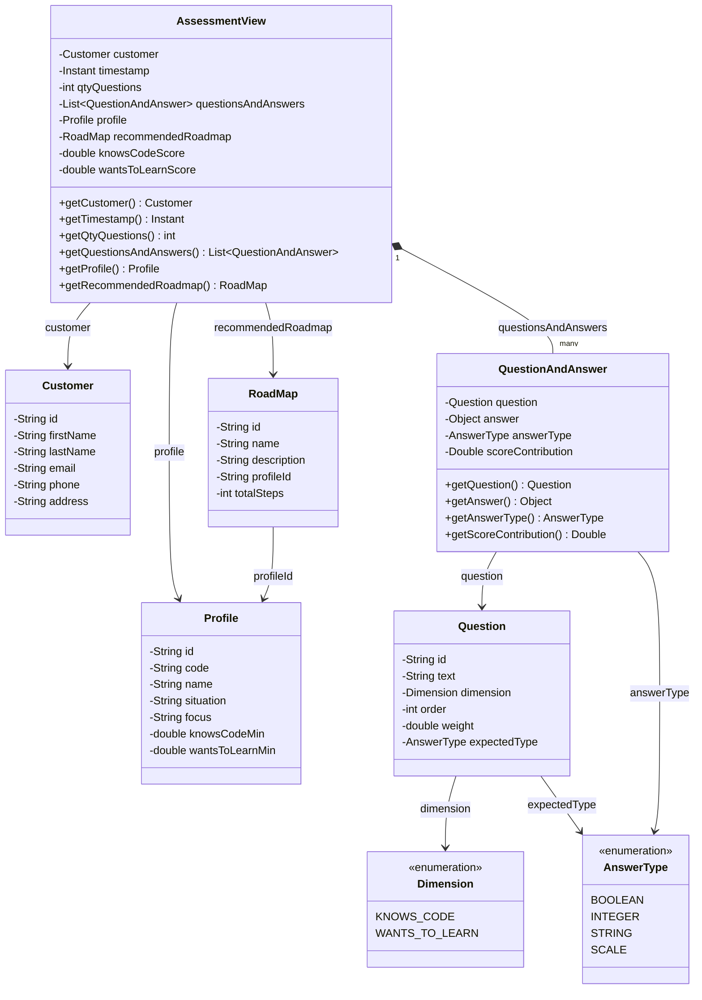

# Data Model — CompassMap

## Summary

This document describes two alternative data model approaches for the CompassMap assessment system:

- **Approach #1 — Normalized relational model** (JPA entities): fine-grained entities with explicit relationships, persisting assessments and answers as separate rows for traceability and analytics.
- **Approach #2 — Aggregate / view-oriented model**: a single `AssessmentView` aggregate that encapsulates the customer, questions-and-answers, computed scores, and the resulting `Profile` / `RoadMap` in one object graph.

---

## Approach #1 — Normalized Relational Model (JPA Entities)

### Rationale

The **data model** is derived from the product goal and technical requirements described in the master documentation:

- `Users` complete a short, guided questionnaire that measures two core dimensions:
  - Whether they already know how to program (`knowsCode`)
  - Whether they want to learn or deepen programming skills (`wantsToLearn`)
- Based on the answers, the system maps the user to one of four well-defined `profiles`.
- Each profile is associated with a recommended learning roadmap.
- The backend must persist:
  - `Customer` information
  - `Profile` definitions and logic
  - `Roadmaps` and their steps
  - `Questionnaire` structure (questions)
  - `Assessment` results (a customer's answers and determined profile/roadmap)

The model follows a normalized relational approach using JPA entities. It separates:
- Reference / configuration data (`Profile`, `Question`, `RoadMap`, `RoadmapStep`)
- Transactional / user data (`Customer`, `Assessment`, `Answer`)

This separation supports:
- Reusable profile and questionnaire definitions
- Historical assessment records per customer
- Traceable answers for scoring, auditing, and future analytics
- Easy extension (e.g., multiple questionnaires, profile evolution, step completion tracking)

### Entities

| Entity | Purpose | Key Attributes |
|--------|---------|----------------|
| `Customer` | Person taking the assessment | `id`, `firstName`, `lastName`, `email`, `phone`, `address` |
| `Profile` | One of the four archetypes (Architect, AI Practitioner, Beginner, Non-Developer) | `id`, `code`, `name`, `situation`, `focus`, `knowsCodeMin`, `wantsToLearnMin` |
| `RoadMap` | High-level learning path recommended for a profile | `id`, `name`, `description`, `profileId`, `totalSteps` |
| `RoadmapStep` | Individual actionable step within a roadmap | `id`, `roadmapId`, `order`, `title`, `description`, `estimatedHours`, `resourceLink` |
| `Question` | Questionnaire item that contributes to profile scoring | `id`, `text`, `dimension` (KNOWS_CODE / WANTS_TO_LEARN), `order`, `weight` |
| `Assessment` | A specific questionnaire session run by a customer, including the final result | `id`, `customerId`, `profileId`, `roadmapId`, `completedAt`, `knowsCodeScore`, `wantsToLearnScore` |
| `Answer` | Individual response given by a customer during an assessment | `id`, `assessmentId`, `questionId`, `value`, `scoreContribution` |

### Relationships

- `Customer` 1 ── * `Assessment`  
  A customer can complete multiple assessments over time.

- `Assessment` * ── 1 `Profile`  
  Each assessment produces exactly one determined profile.

- `Assessment` * ── 1 `RoadMap`  
  Each assessment recommends one roadmap (derived from the profile).

- `Assessment` 1 ── * `Answer`  
  All answers for a session are linked to the assessment.

- `Question` 1 ── * `Answer`  
  Answers reference the original question for scoring and traceability.

- `Profile` 1 ── * `RoadMap`  
  A profile can have one or more recommended roadmaps.

- `RoadMap` 1 ── * `RoadmapStep`  
  A roadmap is composed of ordered steps.

### Current Implementation Status

- Existing **JPA** entities: `Customer`, `RoadMap`
- `Profile` is described in documentation and prototype code (enum + HashMap) but not yet persisted as an entity.
- Questionnaire logic, steps, assessments, and answers are not yet modeled in the database.
- Synthetic data population currently targets only `Customer`.

### Design Notes

- `Profile` can be implemented as a small reference table (4 fixed rows) or an enum-backed entity.
- `Question.dimension` uses an enum or string to distinguish the two scoring axes.
- `Assessment` stores the final scores (`knowsCodeScore`, `wantsToLearnScore`) for quick reporting without recalculating from answers.
- `RoadmapStep` is designed to support future progress tracking per customer (e.g., by adding a `CustomerRoadmapProgress` join entity later).
- All identifiers use `String` (UUID) for simplicity and portability with H2 and future databases.
- The model remains minimal for the initial Spring Boot foundation phase (entities + repositories only).

### Future Considerations (Out of Scope for v1)

- Customer-specific roadmap progress / completion state
- Multiple questionnaire versions
- Profile evolution over time
- Resource / content catalog linked to steps
- Analytics aggregates on assessment results

---

## Approach #2 — Aggregate / View-Oriented Model

### Rationale

Instead of spreading state across normalized tables, the result of a questionnaire session is modeled as a single aggregate, `AssessmentView`. It bundles:

- The `Customer` who took the assessment
- A list of `QuestionAndAnswer` pairs, each carrying the answer value, its `AnswerType`, and the `scoreContribution` it added to the dimension scores
- The computed scores (`knowsCodeScore`, `wantsToLearnScore`)
- The derived `Profile` and the `recommendedRoadmap`

This approach fits a read-model / DTO-oriented design (e.g., a document store or a denormalized JSON column), where the assessment is consumed as a whole rather than queried per-answer.

### Class Diagram

### Key Differences from Approach #1

- `AssessmentView` merges what Approach #1 splits into `Assessment` + `Answer` + joins.
- Answers are polymorphic (`Object answer` + `AnswerType` enum: `BOOLEAN`, `INTEGER`, `STRING`, `SCALE`) instead of a single `value` field.
- `Question` gains an `expectedType` and retains `weight` for scoring.
- `qtyQuestions` is denormalized on the view for quick access.
- No `RoadmapStep` entity is modeled at this level — the roadmap is referenced as a whole.

---

## Conclusions

- **Approach #1** is the better fit for the current Spring Boot + JPA stack: it supports relational queries, per-answer traceability, auditing, and incremental extension (progress tracking, multiple questionnaires). It is the recommended persistence model.
- **Approach #2** is better suited as an API/read-model representation — e.g., the response DTO returned by the assessment endpoints — or as a document-oriented persistence option if the product later favors snapshot semantics over normalized history.
- **Recommended path**: keep Approach #1 for persistence, and derive an `AssessmentView` DTO (Approach #2 shape) for the REST layer, so the API consumers get the aggregated result while the database retains normalized detail.
