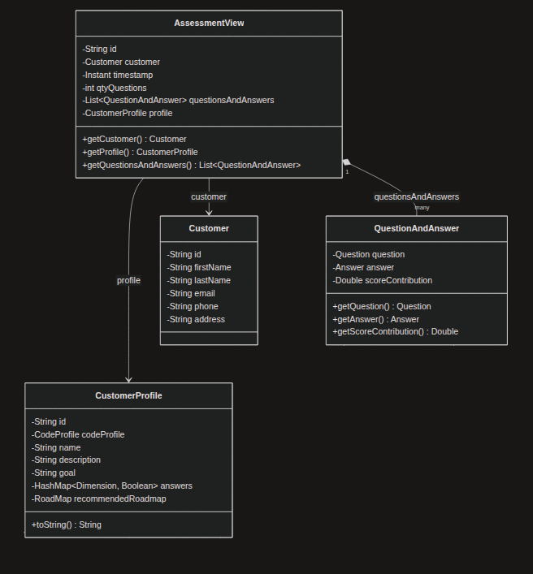
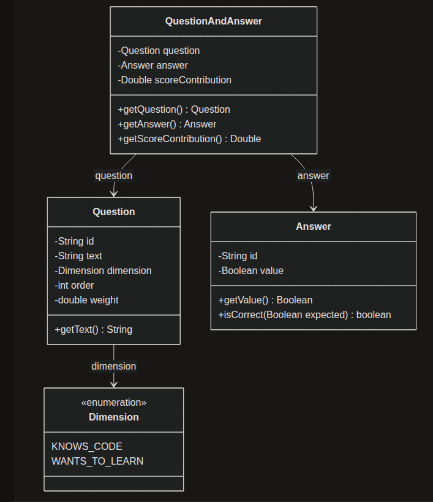
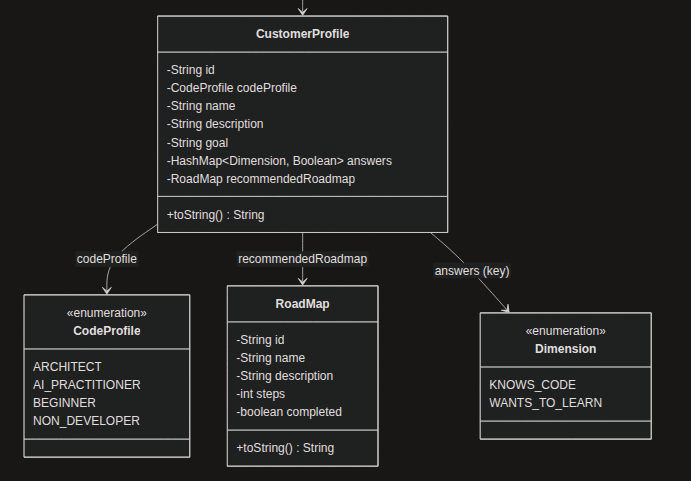
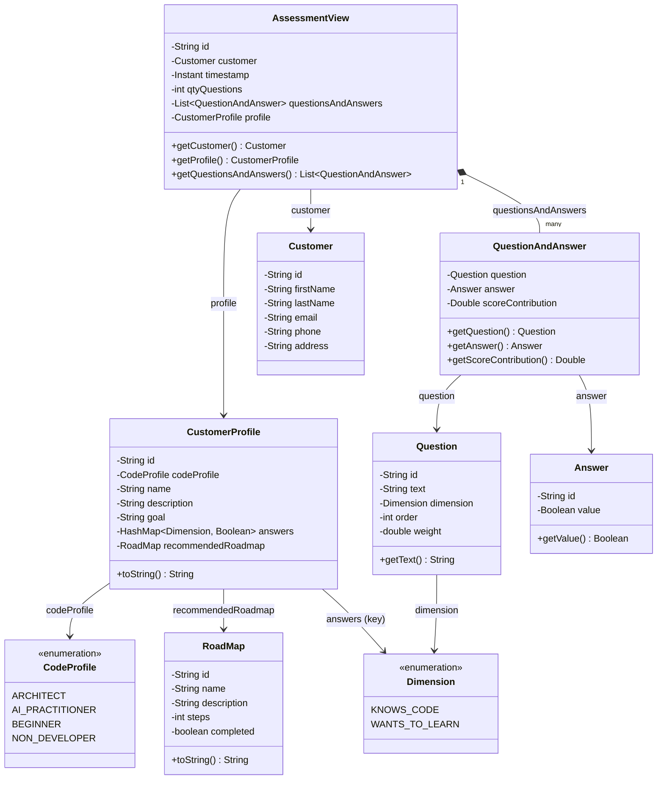

# Data Model v1 — CompassMap (pre-JPA)

## Summary

This document describes the **current state** of the CompassMap data model (`com.example.demo.model`).

This is a **pre-JPA version**: classes are plain Lombok POJOs (`@Data`, `@Builder`, `@NoArgsConstructor`, `@AllArgsConstructor`) with the JPA annotations (`@Entity`, `@Id`, `@ManyToOne`, `@OneToMany`, `@OneToOne`) commented out. There are **no explicit persistence relationships** — object references exist only as Java fields.

Because the classes are independent (no mapped associations, no cascading), each one can still be instantiated and persisted as standalone objects/rows in the database. Object graphs are assembled in memory by the service layer, not by the ORM.

The UML diagrams referenced below live in [`/docs/diagrams/data_model/`](../diagrams/data_model/).

---

## AssessmentView section

`AssessmentView` is the **aggregate / view object** produced when a customer finishes a questionnaire. It bundles the whole result of an assessment session into one object graph:

- **`customer`** — the `Customer` who took the assessment.
- **`timestamp`** — `Instant` marking when the assessment was completed.
- **`qtyQuestions`** — number of questions answered (denormalized for quick access).
- **`questionsAndAnswers`** — `List<QuestionAndAnswer>`, the full trace of what was asked and answered.
- **`profile`** — the resulting `CustomerProfile` computed from the answers.

`@Entity` and `@Id` are commented out: `AssessmentView` is a composed object, not a mapped aggregate root — relationships to `Customer` and `CustomerProfile` are plain Java references.

---

## Question / Answer section (Q&A)

The Q&A part of the model captures the questionnaire structure and the responses:

- **`QuestionAndAnswer`** — links one `Question` to the `Answer` given by the customer, plus `scoreContribution` (the points that answer added to the dimension scores).
- **`Question`** — a questionnaire item: `text`, `dimension` (which axis it scores on), `order` (display position), `weight` (scoring weight).
- **`Answer`** — the customer's response: a `Boolean value` plus `isCorrect(Boolean expected)` to validate against an expected value.
- **`Dimension`** — enum of the scoring axes: `KNOWS_CODE`, `WANTS_TO_LEARN`, `KNOWS_ML`, `WANTS_TO_LEARN_ML`, `KNOWS_GIT`.

All three classes are currently plain POJOs (`@Entity` commented out): a `QuestionAndAnswer` simply holds Java references to its `Question` and `Answer`.

---

## Customer / CustomerProfile section

The customer side of the model:

- **`Customer`** — the person taking the assessment: identity (`id`, `firstName`, `lastName`) and contact data (`email`, `phone`, `address`). Still an `@Entity`.
- **`CustomerProfile`** — the derived archetype for the customer: `codeProfile` (enum), `name`, `description`, `goal`. It will also carry `answers` (`HashMap<Dimension, Boolean>` — the customer's Boolean answer per `Dimension`) and a `recommendedRoadmap`; both fields are currently commented out. Still an `@Entity`.
- **`CodeProfile`** — enum of the profile archetypes: `BEGINNER`, `ARCHITECT`, `NON_DEVELOPER` (+ `AI_PRACTITIONER` planned).
- **`RoadMap`** — the learning path recommended for a profile: `name`, `description`, `steps`, `completed`. Still an `@Entity`.

---

## Entities

| Class | Role | Key fields | Persistence status |
|-------|------|-----------|--------------------|
| `AssessmentView` | Aggregate of one assessment session | `id`, `customer`, `timestamp`, `qtyQuestions`, `questionsAndAnswers`, `profile` | `@Entity` commented — composed object |
| `QuestionAndAnswer` | Question ↔ Answer pair with scoring | `id`, `question`, `answer`, `scoreContribution` | `@Entity` commented — plain POJO |
| `Question` | Questionnaire item | `id`, `text`, `dimension`, `order`, `weight` | `@Entity` commented — plain POJO |
| `Answer` | Customer's response | `id`, `value`, `isCorrect()` | `@Entity` commented — plain POJO |
| `Customer` | Person taking the assessment | `id`, `firstName`, `lastName`, `email`, `phone`, `address` | `@Entity` — independent table |
| `CustomerProfile` | Derived customer archetype | `id`, `codeProfile`, `name`, `description`, `goal` | `@Entity` — independent table |
| `RoadMap` | Recommended learning path | `id`, `name`, `description`, `steps`, `completed` | `@Entity` — independent table |
| `Dimension` | Scoring axes (enum) | `KNOWS_CODE`, `WANTS_TO_LEARN`, `KNOWS_ML`, `WANTS_TO_LEARN_ML`, `KNOWS_GIT` | Enum — not persisted |
| `CodeProfile` | Profile archetypes (enum) | `BEGINNER`, `ARCHITECT`, `NON_DEVELOPER` | Enum — not persisted |

---

## Class diagram (mermaid)

---

## Notes

- The arrows in the diagram express **logical** associations only — in the code they are plain fields, not JPA mappings.
- `Customer`, `CustomerProfile` and `RoadMap` remain `@Entity` and can be persisted independently since nothing references them via mapped relationships.
- `CustomerProfile.answers` and `CustomerProfile.recommendedRoadmap` are commented out in the current code but are part of the intended model.
- `CodeProfile` currently declares `BEGINNER`, `ARCHITECT`, `NON_DEVELOPER`; `AI_PRACTITIONER` is shown in the diagram as the planned fourth archetype.
