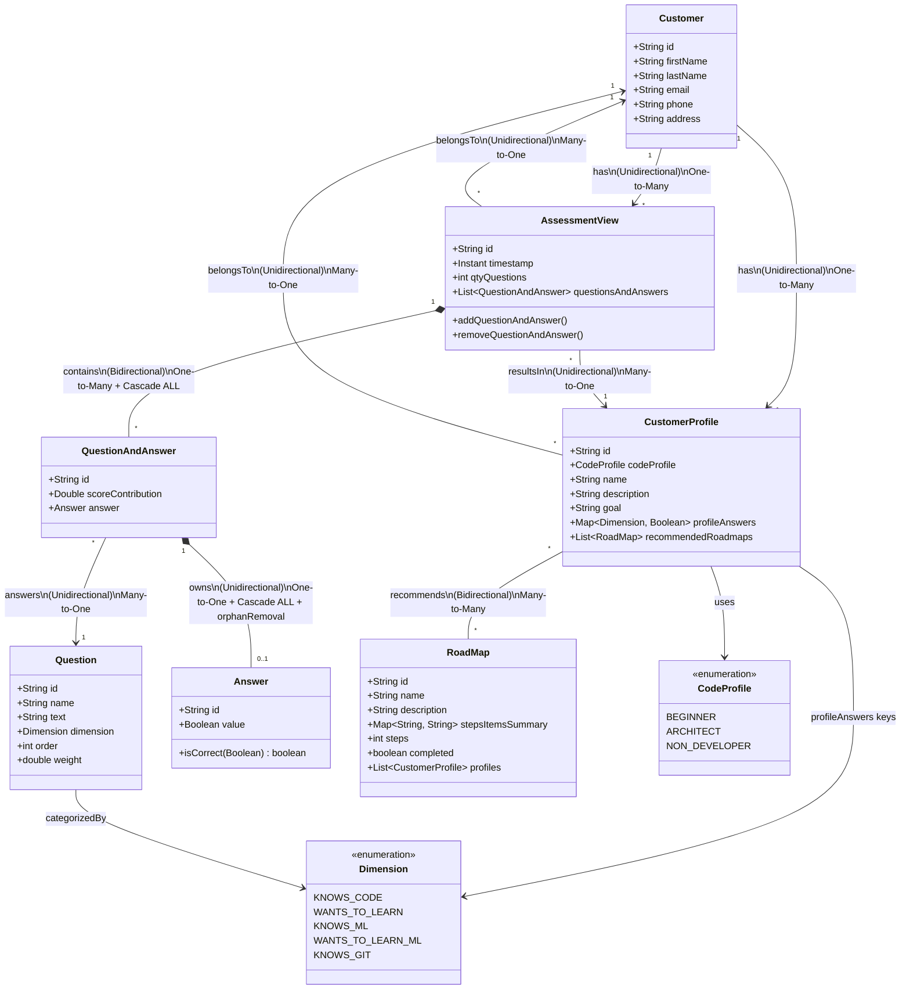

# Data Model v2 — CompassMap (JPA)

## References

- [H2 database screenshots](https://github.com/AlbertProfe/compassMap/tree/task3-assessmentview/docs/screenshots/dataBase)
- [IDE: the 3 task branches](https://github.com/AlbertProfe/compassMap/blob/task3-assessmentview/docs/screenshots/ide/compassMap-tasks-branchs.png)
- [Test docs (gist)](https://gist.github.com/AlbertProfe/9f6877aa4f6f111bb3dd870a4c8bcb67) — test for Task 3 (`AssessmentView`)
- [Branches](https://github.com/AlbertProfe/compassMap/branches) — one per task:
  - Task 1 (`QuestionAndAnswer`) is implemented in the branch [`task1-qanda`](https://github.com/AlbertProfe/compassMap/tree/task1-qanda) — PR [#8](https://github.com/AlbertProfe/compassMap/pull/8)
  - Task 2 (`CustomerProfile`) is implemented in the branch [`task2-profile`](https://github.com/AlbertProfe/compassMap/tree/task2-profile) — PR [#7](https://github.com/AlbertProfe/compassMap/pull/7)
  - Task 3 (`AssessmentView`) is implemented in the branch [`task3-assessmentview`](https://github.com/AlbertProfe/compassMap/tree/task3-assessmentview)

---

## Summary

This document continues [Data Model v1](./dataModel-v1.md) and describes how the **three JPA tasks** defined in [compassMap v2](../compassMap_v2.md) were implemented in `com.example.demo.model`.

In v1 the model was **pre-JPA**: `AssessmentView`, `QuestionAndAnswer`, `Question` and `Answer` had `@Entity` commented out, and every object reference was a plain Java field with no persistence relationship. In v2 every class is an `@Entity` and the references are real JPA relationships (`@OneToMany`, `@ManyToOne`, `@OneToOne`, `@ManyToMany`) with explicit ownership, cascading and FK columns.

| Task | Class | v1 (pre-JPA) | v2 (JPA) |
|------|-------|--------------|----------|
| **Task 1** | `QuestionAndAnswer` | Plain POJO holding `question` and `answer` references | `@Entity`; `@ManyToOne` → `Question` (association), `@OneToOne` → `Answer` (composition), `@ManyToOne` → `AssessmentView` (FK owner) |
| **Task 2** | `CustomerProfile` | `@Entity` without relationships; `answers` and `recommendedRoadmap` commented out | `@ManyToOne` → `Customer`; `@ManyToMany` ↔ `RoadMap` via join table; `profileAnswers` as `@ElementCollection` |
| **Task 3** | `AssessmentView` | Composed object, `@Entity` commented out | `@Entity` aggregate root: `@ManyToOne` → `Customer`, `@OneToMany` → `QuestionAndAnswer` (composition), `@ManyToOne` → `CustomerProfile` |

The sections below also explain the UML symbols used in the v2 class diagram, **applied to our classes**, and why we choose **Composition over Association** in specific cases.

### Symbol legend applied to our classes

| Symbol | Meaning | Example in our model | Explanation |
|--------|---------|----------------------|-------------|
| `*--` | **Composition** (filled diamond) | `AssessmentView *-- QuestionAndAnswer`<br>`QuestionAndAnswer *-- Answer` | Strong ownership. The child **cannot exist** without the parent. When the parent is deleted, the children are also deleted (Cascade ALL + orphanRemoval). |
| `-->` | **Unidirectional Association** | `AssessmentView --> Customer`<br>`QuestionAndAnswer --> Question`<br>`CustomerProfile --> Customer` | Only one side knows about the other. Navigation is possible only in one direction. |
| `--` | **Bidirectional Association** | `CustomerProfile -- RoadMap` | Both sides know about each other. You can navigate in both directions. |
| Multiplicity | Cardinality | `"1" *-- "*"` | How many instances of each class participate in the relationship. |
| Text under arrows | Direction + Type | `(Bidirectional) One-to-Many + Cascade ALL` | Extra information about direction and relationship type. |

### Rule of thumb (used in this model)

| Situation | Prefer |
|-----------|--------|
| Child has no meaning without the parent | **Composition** (`*--`) |
| Child can exist independently / is shared | **Association** (`-->` or `--`) |
| You want automatic deletion of children | Composition + Cascade ALL |
| You want to navigate only one way | Unidirectional (`-->`) |
| You need to navigate both ways | Bidirectional (`--` or `*--` with `mappedBy`) |

- **Composition** — "part-of" relationship with **lifecycle dependency**. The part dies when the whole dies.
- **Association** — "uses" or "knows about" relationship. Both objects can live independently.

---

## Task 1 — Question / Answer section (Q&A)

**v1 → v2:** `QuestionAndAnswer`, `Question` and `Answer` go from plain POJOs to `@Entity` classes. `QuestionAndAnswer` becomes the join entity between the `Question` catalogue and the customer's `Answer`, and the FK owner of the link to `AssessmentView`.

| Relationship | Type | Kind | Why? |
|--------------|------|------|------|
| **QuestionAndAnswer *-- Answer** | One-to-One (Unidirectional) | **Composition** | An `Answer` is created only as part of a `QuestionAndAnswer`. It has no independent life. `orphanRemoval = true` + Cascade ALL means: if you remove the Answer from the QuestionAndAnswer, the Answer is deleted from the database. |
| **QuestionAndAnswer --> Question** | Many-to-One (Unidirectional) | Association | `Question` is reusable master data (catalog). Many answers can reference the same Question. Question lives independently. |
| **QuestionAndAnswer --> AssessmentView** | Many-to-One | Back-reference of the composition | Owning side of `AssessmentView 1..* QuestionAndAnswer` (holds the FK, see Task 3). |

JPA mapping (`QuestionAndAnswer`):

```java
@ManyToOne
@JoinColumn(name = "question_id", nullable = false)
private Question question;

@OneToOne(cascade = CascadeType.ALL, orphanRemoval = true)
@JoinColumn(name = "answer_id")
private Answer answer;

private Double scoreContribution;

@ManyToOne
@JoinColumn(name = "assessment_view_id")
@JsonIgnore
private AssessmentView assessmentView;
```

**Database structure created:**

| `question_and_answer` | |
|---|---|
| `id` | PK |
| `question_id` | FK → `question.id` (not null) |
| `answer_id` | FK → `answer.id` |
| `assessment_view_id` | FK → `assessment_view.id` |
| `score_contribution` | double |

Implementation notes:

- `Answer` is now an `@Entity`; `value` is mapped to column `answer_value` (`value` is reserved in H2).
- `Question` is now an `@Entity` with a new `name` field; `order` is mapped to column `question_order` (`order` is reserved in H2).
- The draft in `compassMap_v2.md` mapped `answer` as `@ManyToOne`; the implementation uses `@OneToOne(cascade = ALL, orphanRemoval = true)` because an `Answer` is never shared → **composition**.

---

## Task 2 — Customer / CustomerProfile section

**v1 → v2:** `CustomerProfile` was already an `@Entity` but had no relationships (`answers` and `recommendedRoadmap` commented out). In v2 it is linked to `Customer` and to many `RoadMap`s, and the per-dimension answers are persisted as `profileAnswers`.

| Relationship | Type | Kind | Why? |
|--------------|------|------|------|
| **CustomerProfile --> Customer** | Many-to-One (Unidirectional) | Association | Same reason as `AssessmentView --> Customer` – Customer is independent. |
| **CustomerProfile -- RoadMap** | Many-to-Many (Bidirectional) | Association | A RoadMap can be recommended to many CustomerProfiles, and a CustomerProfile can have many RoadMaps. Neither owns the other. |

JPA mapping:

```java
// CustomerProfile (owning side)
@Enumerated(EnumType.STRING)
private CodeProfile codeProfile;

@ElementCollection
private Map<Dimension, Boolean> profileAnswers;

@ManyToOne
@JoinColumn(name = "customer_id")
private Customer customer;

@ManyToMany(cascade = CascadeType.ALL, fetch = FetchType.EAGER)
@JoinTable(name = "customer_profile_roadmap",
        joinColumns = @JoinColumn(name = "customer_profile_id"),
        inverseJoinColumns = @JoinColumn(name = "roadmap_id"))
private List<RoadMap> recommendedRoadmaps;

// RoadMap (inverse side)
@ElementCollection
private Map<String, String> stepsItemsSummary;

@ManyToMany(fetch = FetchType.EAGER, mappedBy = "recommendedRoadmaps")
@JsonIgnore
@EqualsAndHashCode.Exclude
private List<CustomerProfile> profiles;
```

**Database structure created:**

| `customer_profile` | |
|---|---|
| `id` | PK |
| `customer_id` | FK → `customer.id` (not unique: a customer has many profiles) |

| `customer_profile_roadmap` (join table) | |
|---|---|
| `customer_profile_id` | FK → `customer_profile.id` |
| `roadmap_id` | FK → `road_map.id` |

Implementation notes:

- v1 `answers` (`HashMap<Dimension, Boolean>`) → v2 `profileAnswers` (`Map<Dimension, Boolean>` + `@ElementCollection`, own table `customer_profile_profile_answers`). `HashMap` as a column does not work with H2 because of the column size limit.
- v1 `recommendedRoadmap` (single `RoadMap`) → v2 `recommendedRoadmaps` (`List<RoadMap>`, `@ManyToMany`), so one profile can recommend several roadmaps.
- `RoadMap` gains `stepsItemsSummary` (`@ElementCollection`, table `road_map_steps_items_summary`) and the inverse `profiles` list.
- `@JsonIgnore` + `@EqualsAndHashCode.Exclude` on `RoadMap.profiles` break the JSON and Lombok recursion between both sides.

---

## Task 3 — AssessmentView section

> Branch: [`task3-assessmentview`](https://github.com/AlbertProfe/compassMap/tree/task3-assessmentview)

**v1 → v2:** `AssessmentView` goes from a composed in-memory object (`@Entity` commented out) to a mapped **aggregate root**. It owns its Q&A rows (composition) and references the shared `Customer` and `CustomerProfile` (associations).

| Relationship | Type | Kind | Why? |
|--------------|------|------|------|
| **AssessmentView *-- QuestionAndAnswer** | One-to-Many (Bidirectional) | **Composition** | An `AssessmentView` **owns** its list of `QuestionAndAnswer`. The Q&A records have no meaning outside a specific assessment. Cascade ALL is used → when the Assessment is deleted, all its QuestionAndAnswers are also deleted. |
| **AssessmentView --> Customer** | Many-to-One (Unidirectional) | Association | A `Customer` can exist without any Assessment. Multiple Assessments can point to the same Customer. Customer is shared, not owned. |
| **AssessmentView --> CustomerProfile** | Many-to-One (Unidirectional) | Association | The resulting profile is a shared reference. The same `CustomerProfile` can be the result of different assessments. |

JPA mapping:

```java
@ManyToOne
@JoinColumn(name = "customer_id")
private Customer customer;

private Instant timestamp;
private int qtyQuestions;

@OneToMany(mappedBy = "assessmentView", cascade = CascadeType.ALL, fetch = FetchType.LAZY)
@JsonProperty(access = JsonProperty.Access.WRITE_ONLY)
@ToString.Exclude
@EqualsAndHashCode.Exclude
private List<QuestionAndAnswer> questionsAndAnswers = new ArrayList<>();

@ManyToOne
@JoinColumn(name = "customer_profile_id")
private CustomerProfile profile;

public void addQuestionAndAnswer(QuestionAndAnswer questionAndAnswer) { ... }
public void removeQuestionAndAnswer(QuestionAndAnswer questionAndAnswer) { ... }
```

**Database structure created:**

| `assessment_view` | |
|---|---|
| `id` | PK |
| `customer_id` | FK → `customer.id` |
| `timestamp` | instant |
| `qty_questions` | int |
| `customer_profile_id` | FK → `customer_profile.id` |

Implementation notes:

- `mappedBy = "assessmentView"`: no join table; the FK `assessment_view_id` lives in `question_and_answer` (`QuestionAndAnswer` is the owning side).
- `questionsAndAnswers` is `WRITE_ONLY`: accepted in the POST body, not serialized (use `/api/v1/assessments/questionsAndAnswers`).
- `addQuestionAndAnswer(...)` / `removeQuestionAndAnswer(...)` keep both sides of the relationship consistent.

---

## Entities

| Class | Role | Key fields | v1 status | v2 status / lifecycle |
|-------|------|-----------|-----------|-----------------------|
| `AssessmentView` | Aggregate root of an assessment run | `id`, `customer`, `timestamp`, `qtyQuestions`, `questionsAndAnswers`, `profile` | `@Entity` commented — composed object | `@Entity` — independent, owns its Q&As |
| `QuestionAndAnswer` | One answered question inside an assessment | `id`, `question`, `answer`, `scoreContribution`, `assessmentView` | `@Entity` commented — plain POJO | `@Entity` — owned by `AssessmentView` |
| `Answer` | The answer value of a `QuestionAndAnswer` | `id`, `value`, `isCorrect()` | `@Entity` commented — plain POJO | `@Entity` — owned by `QuestionAndAnswer` |
| `Question` | Catalog / master data | `id`, `name`, `text`, `dimension`, `order`, `weight` | `@Entity` commented — plain POJO | `@Entity` — independent, shared |
| `Customer` | The user taking assessments | `id`, `firstName`, `lastName`, `email`, `phone`, `address` | `@Entity` — independent table | `@Entity` — independent, shared |
| `CustomerProfile` | Resulting profile of a customer | `id`, `codeProfile`, `name`, `description`, `goal`, `profileAnswers`, `customer`, `recommendedRoadmaps` | `@Entity` — no relationships | `@Entity` — independent, shared |
| `RoadMap` | Recommended learning roadmap | `id`, `name`, `description`, `stepsItemsSummary`, `steps`, `completed`, `profiles` | `@Entity` — independent table | `@Entity` — independent, shared |
| `Dimension` | Scoring axes (enum) | `KNOWS_CODE`, `WANTS_TO_LEARN`, `KNOWS_ML`, `WANTS_TO_LEARN_ML`, `KNOWS_GIT` | Enum | Enum — `@Enumerated(STRING)` / `@ElementCollection` key |
| `CodeProfile` | Profile archetypes (enum) | `BEGINNER`, `ARCHITECT`, `NON_DEVELOPER` | Enum | Enum — `@Enumerated(STRING)` |

---

## Class diagram (mermaid)



---

## Notes

- `Customer "1" --> "*" AssessmentView` and `Customer "1" --> "*" CustomerProfile` are the **logical** reading of the `@ManyToOne` FKs from the customer's side. `Customer` has no `List<AssessmentView>` / `List<CustomerProfile>` fields in code; navigation from a customer goes through repository queries (an optional inverse `@OneToMany(mappedBy = "customer")` is described in `compassMap_v2.md`).
- `CodeProfile.AI_PRACTITIONER`, shown as planned in v1, is still not implemented and is no longer in the diagram.
- Composition children are excluded from `toString`/`equals`/`hashCode` (`@ToString.Exclude`, `@EqualsAndHashCode.Exclude`) to avoid infinite recursion on bidirectional links.
- `AssessmentView.questionsAndAnswers` currently uses `cascade = CascadeType.ALL` **without** `orphanRemoval = true`: deleting the assessment deletes its Q&As, but removing a Q&A from the list does not delete it. Add `orphanRemoval = true` for full composition semantics.
- `CustomerProfile.recommendedRoadmaps` uses `cascade = CascadeType.ALL` even though it is an association; `CascadeType.REMOVE` there could delete shared `RoadMap`s. Consider limiting it to `PERSIST`/`MERGE`.
