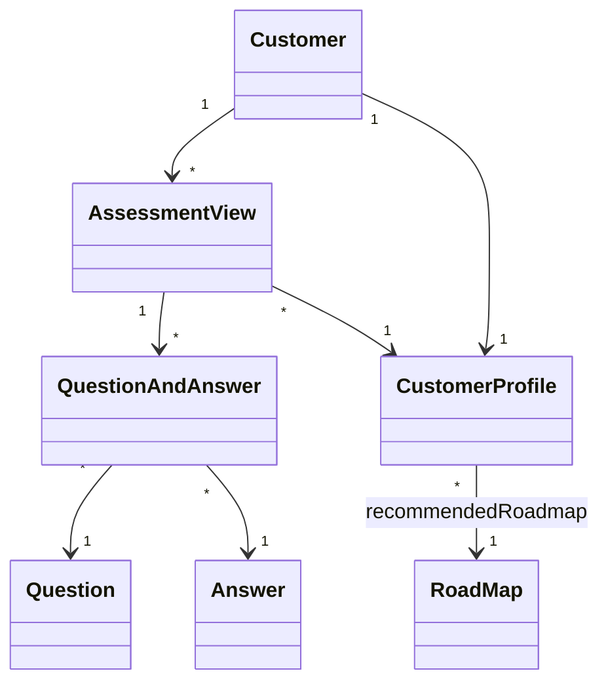
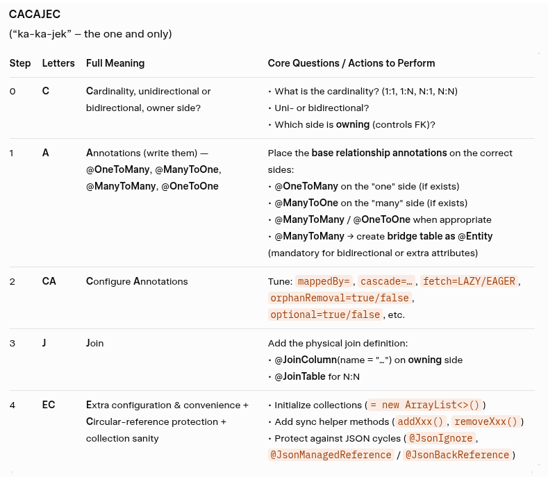

# compassMap masterDoc v2

## Summary

### References

- v1 master doc: [compassMap_v1.md](./compassMap_v1.md)
- `JPA` relationships guide: [JPA_Relationships_Guide.md](https://github.com/AlbertProfe/ApartmentPredictor/blob/master/docs/appends/JPA_Relationships_Guide.md)
- `JPA` annotations (`xml` history): [JPA Before Annotations one-to-many xml](https://github.com/AlbertProfe/ApartmentPredictor/blob/master/docs/appends/JPA_Before_Annotatons:_one-to-many-xml.md)
- `JPA` concepts `albertprofe` wiki: [DI](https://albertprofe.dev/springboot/boot-concepts-jpa.html) / [Relationships](https://albertprofe.dev/springboot/boot-concepts-jpa-3.html)
- Reference project: [ApartmentPredictor github](https://github.com/AlbertProfe/ApartmentPredictor) / [Library3](https://github.com/AlbertProfe/cifojava2022-3/wiki/Library3:-API-Rest-Library-Book-@ManyToMany-@OneToOne-CRUD-with-Swagger)

### Version goal

**Spring Boot Goal #2**

Evolve the `v1` pure-backend foundation (flat entities + `H2`) into a **relational data model** using `JPA` relationship annotations (`@OneToMany`, `@ManyToOne`, `@OneToOne`).

Three JPA tasks:

- **Task 1** — `QuestionAndAnswer`: turn the plain class into an `@Entity` linked to `Question` and `Answer` via `@ManyToOne`
- **Task 2** — `CustomerProfile`: link the profile to `Customer` (`@OneToOne`) and to the recommended `RoadMap` (`@ManyToOne`)
- **Task 3** — `AssessmentView`: turn the plain class into an `@Entity` aggregating `Customer`, `List<QuestionAndAnswer>` (`@OneToMany`) and `CustomerProfile`

> Scope: entities, repositories, services and REST controllers only. No `Thymeleaf`/views, no frontend in this version.

## Project

### Commits

- [compassMap project commits on master](https://github.com/AlbertProfe/compassMap/commits/master/)

### Project structure

- [Project Structure Evolution: v2](https://github.com/AlbertProfe/compassMap/blob/master/docs/appends/project-structure-evolution-v2.md)

## CompassMap data model: v2

### Entities overview

| Entity | Role | Relationships (v2) |
|--------|------|--------------------|
| `Customer` | person taking the assessment | `1..n` `AssessmentView`, `1..1` `CustomerProfile` |
| `Question` | question catalogue (per `Dimension`) | `1..n` `QuestionAndAnswer` |
| `Answer` | a boolean answer value | `1..n` `QuestionAndAnswer` |
| `QuestionAndAnswer` | question + answer + `scoreContribution` | `n..1` `Question`, `n..1` `Answer`, `n..1` `AssessmentView` |
| `CustomerProfile` | resulting profile (`CodeProfile`) + answers map | `1..1` `Customer`, `n..1` `RoadMap` (recommended) |
| `RoadMap` | learning path (`stepsItemsSummary`) | `1..n` `CustomerProfile` (inverse) |
| `AssessmentView` | one assessment run: customer, timestamp, Q&A list, resulting profile | `n..1` `Customer`, `1..n` `QuestionAndAnswer`, `n..1` `CustomerProfile` |

### Model diagram

- [dataModel: diagrams folder](https://github.com/AlbertProfe/compassMap/tree/master/docs/diagrams/data_model)
- [dataModel: v1](https://github.com/AlbertProfe/compassMap/blob/master/docs/appends/dataModel-v1.md)
- [dataModel: v2](https://github.com/AlbertProfe/compassMap/blob/master/docs/appends/dataModel-v2.md)

<!-- TODO: add uml-v2.png / mermaid-v2.txt once the model is implemented -->



## JPA

### Introduction

> In `v1`, every entity lived in its own table with no foreign keys: `CustomerProfile` stored answers as an `@ElementCollection` map and `QuestionAndAnswer`/`AssessmentView` were not even entities. In `v2` we map the real-world relationships — one assessment contains many question/answer pairs, each pair points to one question and one answer, and each assessment produces one customer profile — into the database and Java code.

### The real-world scenario

- **One Customer** takes an assessment
- **One AssessmentView** records the run: timestamp, number of questions, the `List<QuestionAndAnswer>` and the resulting `CustomerProfile`
- **Many QuestionAndAnswer** rows per assessment; each one references **one Question** and **one Answer**
- **One CustomerProfile** per customer, recommending **one RoadMap**

### How JPA relationships work (recap)

- **`@ManyToOne` + `@JoinColumn(name = "..._id")`** goes on the *owning* side — the table that stores the FK column
- **`@OneToMany(mappedBy = "...", cascade = CascadeType.ALL, fetch = FetchType.LAZY)`** goes on the *inverse* side — `mappedBy` names the field on the owning side that controls the relationship
- **`cascade = CascadeType.ALL`**: saving/deleting the parent propagates to children
- **`fetch = FetchType.LAZY`**: collections load on demand (avoids pulling whole object graphs)
- **`@OneToOne`**: FK on the owning side; use `mappedBy` on the inverse side

### JPA Task 1 — `QuestionAndAnswer`

From plain class to the join entity between `Question` and `Answer`:

```java
@Entity
@Data
@Builder
@NoArgsConstructor
@AllArgsConstructor
public class QuestionAndAnswer {

    @Id
    private String id;

    @ManyToOne
    @JoinColumn(name = "question_id")
    private Question question;

    @ManyToOne
    @JoinColumn(name = "answer_id")
    private Answer answer;

    @ManyToOne
    @JoinColumn(name = "assessment_view_id")
    private AssessmentView assessmentView;

    private Double scoreContribution;
}
```

**What this means:**

- **`@Entity` / `@Id`**: the class becomes a persistent table (`question_and_answer`)
- **`@ManyToOne` on `question`**: many Q&A rows can reference the same `Question` (the catalogue is reused across assessments)
- **`@JoinColumn(name = "question_id")`**: FK column in `question_and_answer`
- **`@ManyToOne` on `assessmentView`**: owning side of the `AssessmentView ↔ QuestionAndAnswer` relationship (see Task 3)

**Database structure created:**

| `question_and_answer` | |
|---|---|
| `id` | PK |
| `question_id` | FK → `question.id` |
| `answer_id` | FK → `answer.id` |
| `assessment_view_id` | FK → `assessment_view.id` |
| `score_contribution` | double |

> `Answer` also needs `@Entity` + `@Id` (currently commented out) to be a valid `@ManyToOne` target.

### JPA Task 2 — `CustomerProfile`

```java
@Entity
@Data
@Builder
@NoArgsConstructor
@AllArgsConstructor
public class CustomerProfile {

    @Id
    private String id;

    @Enumerated(EnumType.STRING)
    private CodeProfile codeProfile;

    private String name;
    private String description;
    private String goal;

    // answers of the customer per dimension — kept from v1
    @ElementCollection
    private Map<Dimension, Boolean> answers;

    @OneToOne
    @JoinColumn(name = "customer_id")
    private Customer customer;

    // recommended roadmap
    @ManyToOne
    @JoinColumn(name = "roadmap_id")
    private RoadMap recommendedRoadmap;
}
```

**What this means:**

- **`@OneToOne` on `customer`**: one profile belongs to exactly one customer; `customer_id` FK lives in `customer_profile`
- **`@ManyToOne` on `recommendedRoadmap`**: many profiles can recommend the same `RoadMap` (roadmaps are shared templates); `roadmap_id` FK lives in `customer_profile`
- **`@ElementCollection` answers**: stays as the per-dimension answers table (`customer_profile_answers`) — basic-type map, not an entity relationship

**Inverse sides (optional, add if navigation is needed):**

```java
// Customer.java
@OneToOne(mappedBy = "customer")
private CustomerProfile profile;

// RoadMap.java
@OneToMany(mappedBy = "recommendedRoadmap", fetch = FetchType.LAZY)
private List<CustomerProfile> profiles;
```

### JPA Task 3 — `AssessmentView`

```java
@Entity
@Data
@Builder
@NoArgsConstructor
@AllArgsConstructor
public class AssessmentView {

    @Id
    private String id;

    @ManyToOne
    @JoinColumn(name = "customer_id")
    private Customer customer;

    private Instant timestamp;
    private int qtyQuestions;

    @OneToMany(mappedBy = "assessmentView", cascade = CascadeType.ALL, fetch = FetchType.LAZY)
    private List<QuestionAndAnswer> questionsAndAnswers;

    @ManyToOne
    @JoinColumn(name = "customer_profile_id")
    private CustomerProfile profile;
}
```

**What this means:**

- **`@ManyToOne` on `customer`**: one customer can run many assessments; `customer_id` FK in `assessment_view`
- **`@OneToMany(mappedBy = "assessmentView", cascade = ALL)`**: the assessment owns its Q&A rows — saving an `AssessmentView` cascades to all `QuestionAndAnswer` children; `mappedBy` delegates the FK to `question_and_answer.assessment_view_id` (no join table)
- **`@ManyToOne` on `profile`**: the resulting profile is looked up, not owned — assessments reference shared `CustomerProfile` templates

**Database structure created:**

| `assessment_view` | |
|---|---|
| `id` | PK |
| `customer_id` | FK → `customer.id` |
| `timestamp` | instant |
| `qty_questions` | int |
| `customer_profile_id` | FK → `customer_profile.id` |

### Common pitfalls and best practices

- **Don't forget bidirectional consistency** — when adding/removing `QuestionAndAnswer` use a helper (`addQuestionAndAnswer`) that sets both sides
- **Don't use `EAGER` on large collections** — keep `LAZY` on `@OneToMany`
- **`@Data` + relationships**: Lombok `toString()`/`equals()` traverse both sides and can loop or trigger lazy loads — exclude relationship fields if needed (`@ToString.Exclude`)
- **`order` is reserved in H2** — `Question.order` already maps to `question_order`
- **N+1 risk** on `AssessmentView.questionsAndAnswers` — plan a `JOIN FETCH` query or `@EntityGraph` in the repository




## Repositories / REST

- [Postman DOCS](https://documenter.getpostman.com/view/7473960/2sBYHSy1U9)

Tasks to do:

- [ ] `QuestionAndAnswerRepository` — exists; add `findByAssessmentViewId(...)`
- [ ] `AnswerRepository` — new, once `Answer` is an entity
- [ ] `AssessmentViewRepository` — new
- [ ] `AssessmentViewRestController` — `GET /assessments`, `POST /assessments` (submit questionnaire, compute profile)
- [ ] `PopulatorDB` — seed questions, answers, roadmaps, profiles, one sample assessment

## Maven

- [Maven v1](https://github.com/AlbertProfe/compassMap/blob/master/docs/compassMap_v1.md#maven)
- [pom.xml](https://github.com/AlbertProfe/compassMap/blob/master/docs/compassMap_v1.md#pomxml)

## Tech Stack

- [Tech stack v1](https://github.com/AlbertProfe/compassMap/blob/master/docs/compassMap_v1.md#tech-stack)

Same as v1: Java 21, Spring Boot, Spring Data JPA, H2, Lombok, IntelliJ IDEA.
