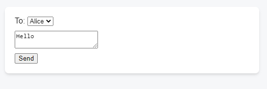

# React Practice Exercises for CompassMap

---

## 1. Email Form — useState, Controlled Components, Event Handlers

**React concepts:** `useState`, controlled components, `onChange`, `onSubmit`, event handlers, JSX

Build a form that lets the user pick a recipient from a dropdown, type a message, and send it with a five-second delay. The alert shows the values that were current when the button was clicked — even if the user edits the fields during the delay.



### Think first — before you code:

- **How many `useState` hooks do you need?** How do you decide?
- **What value does each state variable hold?** What is its initial value?
- **Which UI element is tied to which state variable?**
- **What changes when the user types in the textarea?** What changes when the user picks a different recipient?
- **What happens when the form is submitted?** Why do we call `e.preventDefault()`?

### Starter code

Copy this skeleton into your editor and fill in the `// TODO` parts:

```jsx
// App.js
import { /* TODO: hooks */ } from 'react';

export default function Form() {
  // TODO: add useState hooks here

  function handleSubmit(e) {
    // TODO: prevent default form submission
    // TODO: use setTimeout to show an alert after 5 seconds
  }

  return (
    <form onSubmit={handleSubmit}>
      <label>
        To:{' '}
        <select
          value={/* TODO: bind to state */}
          onChange={/* TODO: update state */}>
          <option value="Alice">Alice</option>
          <option value="Bob">Bob</option>
        </select>
      </label>
      <textarea
        placeholder="Message"
        value={/* TODO: bind to state */}
        onChange={/* TODO: update state */}
      />
      <button type="submit">Send</button>
    </form>
  );
}
```

---

## Summary — React Concepts Covered

| #   | Exercise      | Key React Topics                                                     |
| --- | ------------- | -------------------------------------------------------------------- |
| 1   | Email Form    | `useState`, controlled components, `onChange`, `onSubmit`, closures  |
